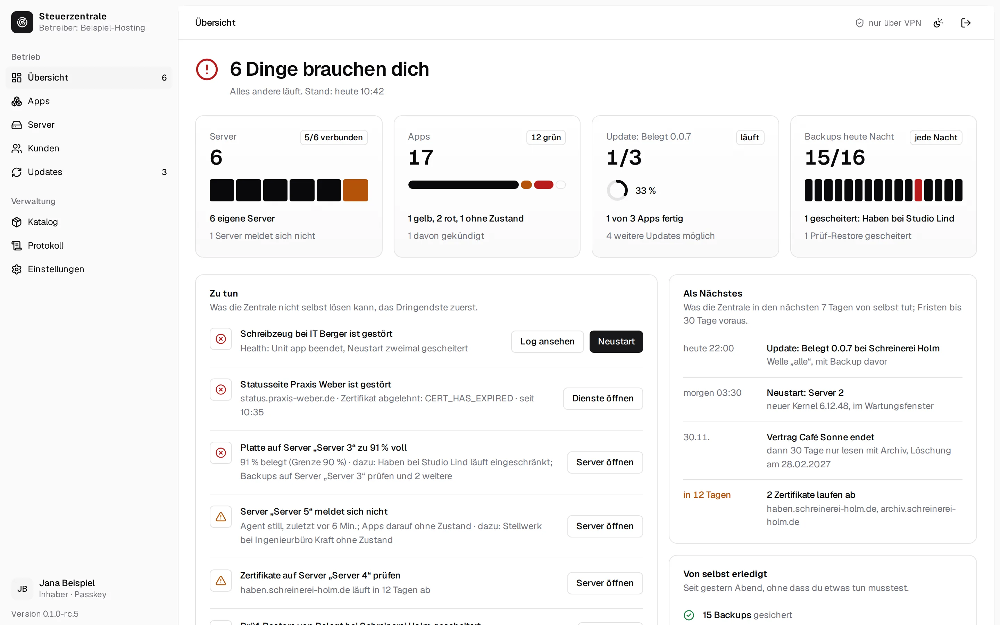

<div align="center">

<h1>Deine Apps. Deine Server. Eine Zentrale.</h1>

<picture>
  <source media="(prefers-color-scheme: dark)" srcset="docs/assets/screenshots/uebersicht-dunkel.webp">
  
</picture>

**Open-Source-Betrieb für die Apps der Speicherstadt: installieren, aktualisieren, sichern und überwachen, auf deinen eigenen Servern.**

Für IT-Dienstleister und Hoster, die Haben, Belegt, Kontext, Schreibzeug, Stellwerk, Fixpunkt, Kennwort und Soll für
sich oder ihre Kunden betreiben: auf gemeinsamen Servern, auf einem Server je Kunde oder beim Kunden im Haus.


[](https://github.com/Speicherstadt/steuerzentrale/actions/workflows/ci.yml)
[](https://github.com/Speicherstadt/steuerzentrale/releases)
[](LICENSE)
[](https://speicherstadt.github.io/steuerzentrale/)
[](https://speicherstadt.github.io/steuerzentrale/demo/)
[](https://speicherstadt.github.io/steuerzentrale/installation.html)
[](https://hub.docker.com/r/tristanteu/steuerzentrale)

[Warum?](#warum-die-steuerzentrale) •
[Funktionen](#funktionen) •
[Demo](https://speicherstadt.github.io/steuerzentrale/demo/) •
[Schnellstart](#schnellstart) •
[FAQ](#faq) •
[Dokumentation](https://speicherstadt.github.io/steuerzentrale/) •
[Entwicklung](#entwicklung)

<sub>English: self-hosted operations for the open-source apps of Speicherstadt. One control plane with a web UI, one agent per server that connects out by itself and only runs what an app's signed manifest describes: installs, update waves with rollback, restic backups with test restores, health and external checks, customers, contracts and usage reports. The interface comes in German and English; the documentation is in German.</sub>

</div>

> [!WARNING]
> **Release-Kandidat:** Stufe 1 (Selbstbetrieb) ist fertig gebaut und läuft in der CI auf echten VMs durch, im
> Echtbetrieb ist die Steuerzentrale noch neu. Vor jedem Update der Zentrale ein Backup machen
> ([Zentrale sichern](https://speicherstadt.github.io/steuerzentrale/zentrale-sichern.html)); Apps aktualisiert sie ohnehin nur mit Backup davor.

## Warum die Steuerzentrale?

**Wer Apps für andere betreibt, soll nicht jeden Server von Hand pflegen müssen, und auch nicht alles einem fremden Dienst geben.** 🇩🇪 🇪🇺

Die Apps der Speicherstadt laufen auf deinem Server. Sobald es mehr als einer ist, wird das Drumherum zur Arbeit:
Updates zur richtigen Zeit, Backups, die sich auch zurückspielen lassen, Zertifikate, volle Platten, Kunden mit
Verträgen. Die Steuerzentrale macht das an einer Stelle, ohne dass ein Server einen Port für sie öffnet.

- **Nur was das Manifest beschreibt:** der Agent führt keine Shell und keinen freien Befehl aus, nur die Aktionen
  aus dem signierten Manifest einer App; ein Image nur per Digest
- **Der Agent verbindet sich selbst:** ausgehende WSS-Verbindung mit Client-Zertifikat, kein offener Port am Server,
  auch beim Kunden hinter dessen Firewall
- **Updates in Wellen, mit Rückweg:** erst die eigenen Installationen, dann alle; vor jedem Update ein Backup,
  nie in einer Sperrzeit der App, bei roter Health zurück auf die alte Version
- **Backups, die geprüft sind:** restic je Installation auf dein S3-Ziel, mit regelmäßigem Prüf-Restore auf einer Kopie
- **Rootless und getrennt:** jede Installation unter eigenem Linux-Nutzer mit eigenem Netz, Podman Quadlets unter
  systemd, Caddy als Pforte davor
- **Nichts ist eingebaut:** die Zentrale kennt keine App, nur Manifeste; eine neue App braucht keinen neuen Code

## Funktionen

Kurz je Bereich; die Details stehen auf der verlinkten Seite der [Dokumentation](https://speicherstadt.github.io/steuerzentrale/).

| Bereich | Was die Steuerzentrale kann |
|---|---|
| 🧭 [Übersicht](https://speicherstadt.github.io/steuerzentrale/uebersicht.html) | Alles, was Aufmerksamkeit braucht, nach Schwere geordnet: Störungen, rote und gelbe Installationen, stille Agenten, Prüfungen, gescheiterte Aufträge; jeder Eintrag führt zu seiner Ursache |
| 🖥️ [Server hinzufügen](https://speicherstadt.github.io/steuerzentrale/server-hinzufuegen.html) | Ein Befehl mit Einmal-Token; `install.sh` richtet auf Debian 13 oder Ubuntu 24.04 Podman, unattended-upgrades und den signierten Agenten ein; Zertifikat rotiert selbst, sofort sperrbar |
| 📦 [Apps installieren](https://speicherstadt.github.io/steuerzentrale/installieren.html) | Dialog mit Kunde, Server und Adresse; Platzierung nach Platz und Art des Servers; Einstellungen als Formular aus dem Manifest, Geheimnisse als Podman-Secrets |
| 📜 [Manifeste und Versionen](https://speicherstadt.github.io/steuerzentrale/manifeste.html) | Signierte Manifeste je App und Version, geprüft mit minisign; was ein Manifest nicht nennt, läuft nicht |
| 🔄 [Updates](https://speicherstadt.github.io/steuerzentrale/updates.html) | Wellen „intern“ und „alle“, Wartungsfenster je Server, Sperrzeiten je App, Backup davor, Rückkehr bei roter Health; [Agent](https://speicherstadt.github.io/steuerzentrale/agent-updates.html) und [Betriebssystem](https://speicherstadt.github.io/steuerzentrale/betriebssystem.html) mit Neustart im Fenster |
| 💾 [Backups](https://speicherstadt.github.io/steuerzentrale/backups.html) | restic je Installation auf das S3-Ziel des Betreibers, Prüf-Restore, Wiederherstellen mit Grund; die [Zentrale selbst](https://speicherstadt.github.io/steuerzentrale/zentrale-sichern.html) getrennt von ihrem Schlüssel |
| 🩺 [Health und Zustand](https://speicherstadt.github.io/steuerzentrale/zustand.html) | Units und Health alle 30 Sekunden, grün, gelb, rot oder unbekannt, immer mit Grund; nie grün ohne frische Meldung |
| 🌐 [Prüfung von außen](https://speicherstadt.github.io/steuerzentrale/aussen.html) · [DNS](https://speicherstadt.github.io/steuerzentrale/dns.html) | DNS, Zertifikat, Pforte und Health über den öffentlichen Namen, unabhängig vom Agenten; Verfügbarkeit je Monat; DNS-Einträge über die Cloudflare-API |
| 🔍 [Prüfungen der Server](https://speicherstadt.github.io/steuerzentrale/pruefungen.html) | Platte, Zertifikate, Backup-Alter, offene Ports, die kein Manifest nennt, Uhrzeit; SSH-Anmeldungen als Ereignis |
| 🔔 [Benachrichtigungen](https://speicherstadt.github.io/steuerzentrale/benachrichtigungen.html) | Mail über dein SMTP und signierte Webhooks, eine Nachricht je Störung und eine zur Behebung, Ruhezeit |
| ⚙️ [Aktionen](https://speicherstadt.github.io/steuerzentrale/aktionen.html) · [Einstellungen](https://speicherstadt.github.io/steuerzentrale/einstellungen.html) | Neustart, Log-Auszug, nur lesen, Einstellungen ändern, jeweils mit Grund im Audit-Log und nie in einer Sperrzeit |
| 👥 [Kunden und Verträge](https://speicherstadt.github.io/steuerzentrale/kunden.html) | Ansprechperson, SLA, Vertragsende; nach der Kündigung letztes Backup, Archiv-Link für den Kunden und Löschung mit Protokoll |
| 🛟 [Support-Zugang](https://speicherstadt.github.io/steuerzentrale/support.html) | Zeitlich begrenzt, mit Grund, für den Kunden sichtbar |
| 📈 [Leistungen](https://speicherstadt.github.io/steuerzentrale/leistungen.html) | Je Kunde und Monat: Installationen, Speicher, Support-Zeit, Verfügbarkeit; Export als CSV |
| 🔐 [Anmeldung und Rollen](https://speicherstadt.github.io/steuerzentrale/anmeldung.html) | Passkey oder Passwort mit TOTP, Rollen Inhaber, Technik, Support; Oberfläche nur über WireGuard |
| 🛡️ [Sicherheit](https://speicherstadt.github.io/steuerzentrale/sicherheit.html) | Bedrohungsmodell mit Test je Bedrohung, Notzugang per SSH, TOMs nach Art. 32 DSGVO |
| 🧩 [Manifest für App-Entwickler](https://speicherstadt.github.io/steuerzentrale/manifest.html) | Ein Schema für Units, Volumes, Secrets, Health, Backup, Aktionen und Einstellungen einer App |

## Screenshots

<table>
  <tr>
    <td width="50%"><picture><source media="(prefers-color-scheme: dark)" srcset="docs/assets/screenshots/server-dunkel.webp"></picture><br><sub><b>Server</b>: gemeinsam, eigen oder beim Kunden, mit Agent und Zustand</sub></td>
    <td width="50%"><picture><source media="(prefers-color-scheme: dark)" srcset="docs/assets/screenshots/installation-dunkel.webp"></picture><br><sub><b>Installation</b>: Units, Health, Backup und Prüfung von außen</sub></td>
  </tr>
  <tr>
    <td width="50%"><picture><source media="(prefers-color-scheme: dark)" srcset="docs/assets/screenshots/updates-dunkel.webp"></picture><br><sub><b>Updates</b>: in Wellen, mit Backup davor und Rückweg</sub></td>
    <td width="50%"><picture><source media="(prefers-color-scheme: dark)" srcset="docs/assets/screenshots/backups-dunkel.webp"></picture><br><sub><b>Backups</b>: restic je Installation, mit Prüf-Restore</sub></td>
  </tr>
</table>

Alles zum Durchklicken, mit Beispieldaten und ohne Server: die **[Demo](https://speicherstadt.github.io/steuerzentrale/demo/)**.

## Schnellstart

Die Steuerzentrale läuft als ein Container (`tristanteu/steuerzentrale` oder `ghcr.io/speicherstadt/steuerzentrale`,
amd64 und arm64) rootless unter Podman, mit Caddy als Pforte davor. Du brauchst einen Server mit Debian 13 oder
Ubuntu 24.04, zwei DNS-Namen (Oberfläche und `agent.`) und WireGuard, denn die Oberfläche antwortet nur im VPN.

### 1. Von einem Agenten aufsetzen lassen

Gib Claude Code oder einem anderen Coding-Agenten dieses Repository und SSH-Zugang zu deinem Server und sag:
„Setz die Steuerzentrale auf meinem Server auf, nach der [Installationsanleitung](https://speicherstadt.github.io/steuerzentrale/installation.html).“

### 2. Manuell

Die [Installation](https://speicherstadt.github.io/steuerzentrale/installation.html) geht Schritt für Schritt durch: Release-Dateien laden und gegen die
Signatur prüfen, die Zentrale als Quadlet unter eigenem Nutzer starten, die Pforte davorsetzen, den ersten Inhaber
mit dem Einrichtungscode aus dem Log anlegen und den Agenten desselben Servers beitreten lassen. Genau diese
Schritte geht die CI mit jedem Release-Kandidaten in einer VM durch.

Danach in der Oberfläche: [Server hinzufügen](https://speicherstadt.github.io/steuerzentrale/server-hinzufuegen.html), Manifest einer App importieren,
[App installieren](https://speicherstadt.github.io/steuerzentrale/installieren.html).

> [!IMPORTANT]
> Sichere `STEUERZENTRALE_SECRET_KEY` an einem zweiten Ort, getrennt vom Backup der Datenbank. Ohne ihn sind die
> Geheimnisse aller Installationen nach einer Wiederherstellung nicht mehr lesbar
> ([Zentrale sichern](https://speicherstadt.github.io/steuerzentrale/zentrale-sichern.html)).

## FAQ

<details>
<summary><b>Was kostet die Steuerzentrale?</b></summary>

Die Software ist kostenlos (AGPL). Du brauchst einen Server für die Zentrale und die Server für deine Apps; die
Zentrale kann auch auf einem Server laufen, der selbst Apps betreibt.
</details>

<details>
<summary><b>Für wen ist das?</b></summary>

Für alle, die mehr als eine Installation der Speicherstadt-Apps betreuen: IT-Dienstleister und Hoster mit Kunden,
aber auch eine Firma mit mehreren Standorten. Für eine einzelne App auf einem Server reicht deren eigene Anleitung.
</details>

<details>
<summary><b>Läuft auch eine App, die nicht aus der Speicherstadt kommt?</b></summary>

Technisch braucht die Zentrale nur ein Manifest ([Manifest](https://speicherstadt.github.io/steuerzentrale/manifest.html)), keine App ist eingebaut. Ein
Manifest muss aber mit dem Schlüssel des Betreibers signiert sein, und die Werte darin stammen aus den Quellen der App.
</details>

<details>
<summary><b>Muss ich beim Kunden einen Port öffnen?</b></summary>

Nein. Der Agent verbindet sich von sich aus zur Zentrale (`agent.<domain>`, mTLS). Am Server sind nur 80 und 443
für die Apps selbst offen.
</details>

<details>
<summary><b>Was darf die Zentrale auf meinem Server?</b></summary>

Nur die Aktionen, die das signierte Manifest einer App beschreibt, mit festen Argumenten: kein Shell-Befehl, kein
freies `podman exec`, kein Image ohne Digest. Eine übernommene Zentrale mit einem fremden Manifest bringt keinen Code
auf einen Server; das prüft ein Test ([Sicherheit](https://speicherstadt.github.io/steuerzentrale/sicherheit.html)).
</details>

<details>
<summary><b>Docker oder Podman?</b></summary>

Podman, rootless, mit Quadlets unter systemd. Jede Installation bekommt einen eigenen Linux-Nutzer, ein eigenes Netz
und eigene Volumes; das Image der Zentrale gibt es trotzdem auch auf Docker Hub.
</details>

<details>
<summary><b>Wird die Steuerzentrale mit KI entwickelt?</b></summary>

Ja, mit Coding-Agenten in einem festen Ablauf: ein Punkt der [Bauliste](BAULISTE.md) je Pull Request, Tests zuerst,
für Sicherheitsrelevantes ein unabhängiges Review, das nur meldet, was ein fehlschlagender Test belegt. Wie das
abläuft, steht unter [Mitwirken](https://speicherstadt.github.io/steuerzentrale/mitwirken.html).
</details>

## Dokumentation

Alles im Detail, mit Suche: **https://speicherstadt.github.io/steuerzentrale/**. Jede Funktion oben verlinkt ihre Seite; dazu kommen:

- **Einstieg:** [Installation](https://speicherstadt.github.io/steuerzentrale/installation.html), [Server hinzufügen](https://speicherstadt.github.io/steuerzentrale/server-hinzufuegen.html),
  [Apps installieren](https://speicherstadt.github.io/steuerzentrale/installieren.html)
- **Hintergrund:** [Projektplan](https://speicherstadt.github.io/steuerzentrale/plan.html) (Architektur, Entscheidungen, Datenmodell), [Pforte](https://speicherstadt.github.io/steuerzentrale/pforte.html),
  [Aufträge](https://speicherstadt.github.io/steuerzentrale/auftraege.html), [Release](https://speicherstadt.github.io/steuerzentrale/release.html)

## Entwicklung

[](https://www.typescriptlang.org)
[](https://bun.sh)
[](https://www.solidjs.com)
[](https://tanstack.com/router)
[](https://hono.dev)
[](https://vite.dev)
[](https://orm.drizzle.team)

Voraussetzungen: Bun in der Version aus `packageManager` in `package.json` und Git. Für die Tests des Agenten
Podman mit systemd; die CI hat beides.

```sh
bun install
bun run dev:demo          # Oberfläche mit Beispieldaten, ohne Zentrale: http://localhost:5181
bun run dev:zentrale      # Zentrale auf Port 18300
bun run dev:web           # Oberfläche auf Port 5181
bun run check             # Typen, Lint, Tests, Build
bun run e2e               # Playwright gegen Zentrale und Oberfläche
```

Aufbau und Entscheidungen stehen im [Projektplan](https://speicherstadt.github.io/steuerzentrale/plan.html), alles Weitere unter [Mitwirken](https://speicherstadt.github.io/steuerzentrale/mitwirken.html).

| Paket | Inhalt |
|---|---|
| `apps/zentrale` | Hono-Server: API, Datenbank (SQLite mit Drizzle), Aufträge, Prüfungen, Verbindung zu den Agenten |
| `apps/web` | Oberfläche (Solid 2, TanStack Router), Demo mit Beispieldaten |
| `apps/agent` | Agent für jeden Server, mit `bun build --compile` zu einem Binary |
| `packages/manifest` | Schema der Manifeste, Platzierung, Quadlet-Units, Podman-Secrets und Caddy-Snippets, ohne I/O |
| `packages/planung` | Update-Wellen, Sperrzeiten, Wartungsfenster, Prüfungen der Server, ohne I/O |
| `packages/protokoll` | Nachrichten zwischen Zentrale und Agent, versioniert |
| `packages/ui` | Bausteine der Oberfläche, Texte auf Deutsch und Englisch (Paraglide) |
| `install/install.sh` | Richtet einen Server ein und lässt den Agenten beitreten |

## Mehr von uns

Die Apps, die die Steuerzentrale betreibt, und weitere Open-Source-Apps für deinen eigenen Server: **[speicherstadt.org](https://speicherstadt.org)**

## Mitwirken

Fehler und Ideen gern als Issue. Was vor einem Pull Request laufen muss und was er enthält, steht unter
[Mitwirken](https://speicherstadt.github.io/steuerzentrale/mitwirken.html); Beiträge mit Developer Certificate of Origin (`git commit -s`), kein CLA.
Sicherheitslücken bitte vertraulich melden, wie in [SECURITY.md](SECURITY.md) beschrieben.

## Sterne im Verlauf

<a href="https://www.star-history.com/#Speicherstadt/steuerzentrale&Date">
  <picture>
    <source media="(prefers-color-scheme: dark)" srcset="https://api.star-history.com/svg?repos=Speicherstadt/steuerzentrale&type=Date&theme=dark">
    
  </picture>
</a>

---

<div align="center">

⭐ **Gefällt dir die Steuerzentrale?** Ein [Stern auf GitHub](https://github.com/Speicherstadt/steuerzentrale) hilft anderen, sie zu finden.

[Fehler melden](https://github.com/Speicherstadt/steuerzentrale/issues/new) &nbsp;·&nbsp; [Demo](https://speicherstadt.github.io/steuerzentrale/demo/) &nbsp;·&nbsp; [Dokumentation](https://speicherstadt.github.io/steuerzentrale/)

<sub>Lizenz: <a href="LICENSE">AGPL-3.0</a> · © Tristan Teufel und Mitwirkende<br>
Wer eine veränderte Fassung der Steuerzentrale für andere übers Netz betreibt, muss ihnen den Quellcode anbieten (§ 13 AGPL).<br>
Cloudflare, Docker und GitHub sind Marken ihrer Inhaber; die Steuerzentrale steht mit diesen Unternehmen nicht in Verbindung.</sub>

</div>
