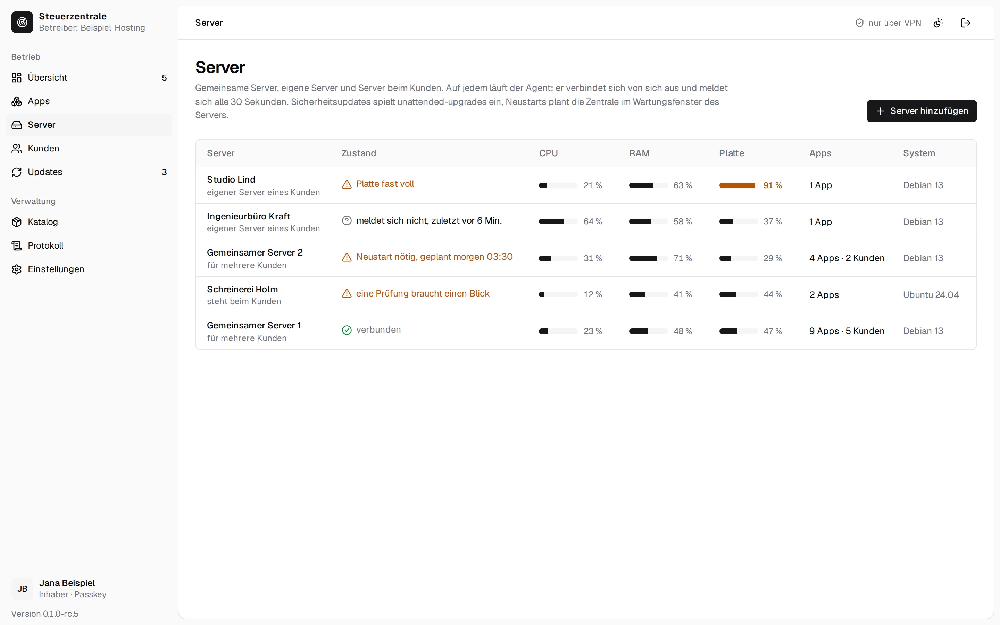
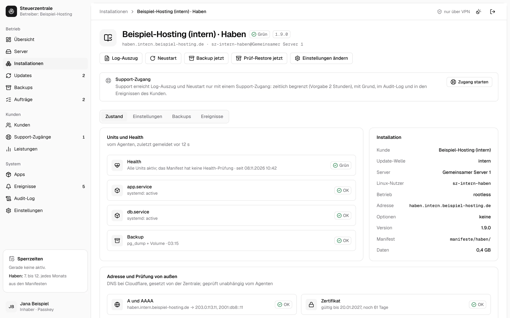
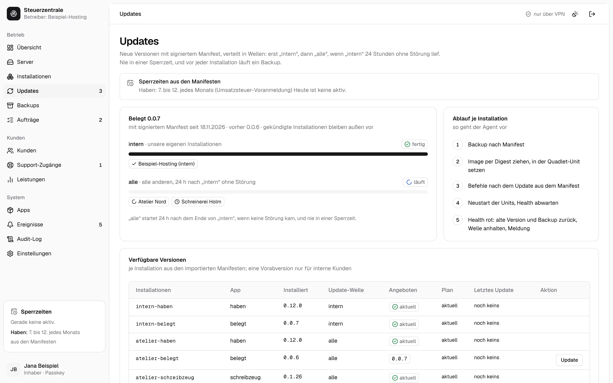
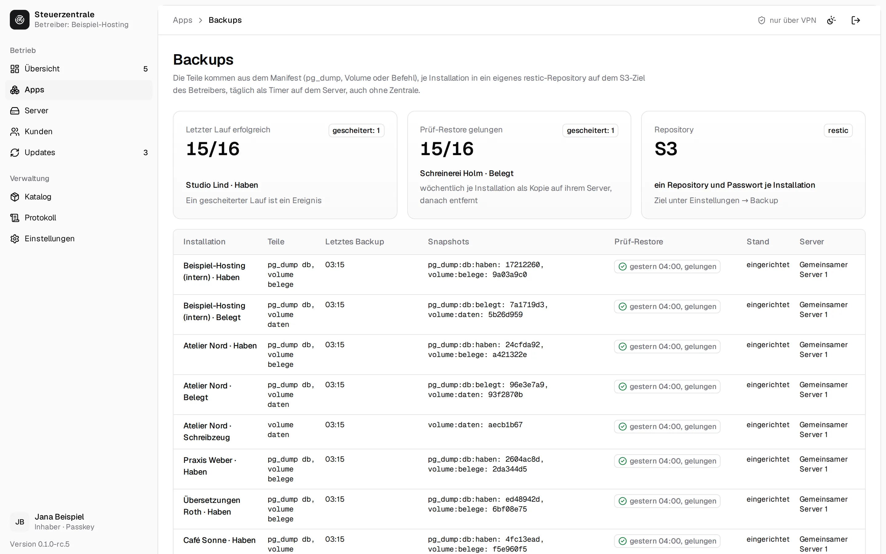
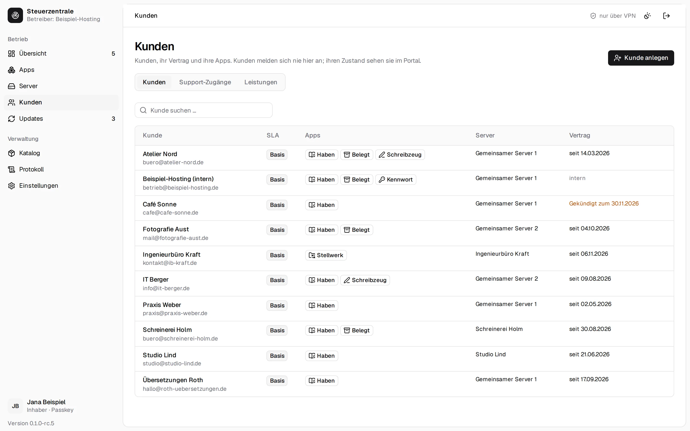
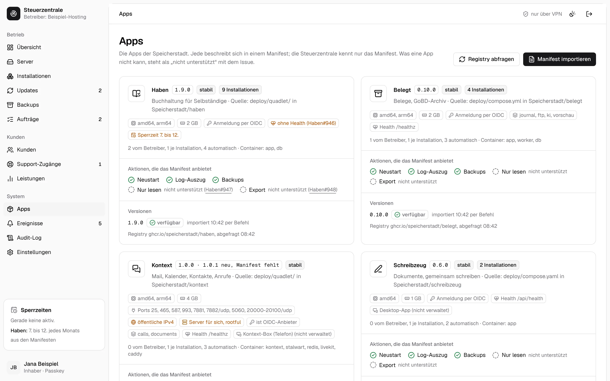

<div align="center">

<h1>Steuerzentrale</h1>

**Die Apps der Speicherstadt auf eigenen Servern betreiben: installieren, aktualisieren, sichern, überwachen.**

Eine Zentrale mit Oberfläche, ein Agent auf jedem Server, der sich selbst verbindet und nur ausführt,
was das signierte Manifest einer App beschreibt. Für Betreiber, die Haben, Belegt, Kontext, Schreibzeug,
Stellwerk, Fixpunkt, Kennwort und Soll für sich oder ihre Kunden hosten.


[](https://github.com/Speicherstadt/steuerzentrale/actions/workflows/ci.yml)
[](https://github.com/Speicherstadt/steuerzentrale/releases)
[](LICENSE)
[](https://speicherstadt.github.io/steuerzentrale/)
[](https://speicherstadt.github.io/steuerzentrale/demo/)

[Demo](https://speicherstadt.github.io/steuerzentrale/demo/) •
[Funktionen](#funktionen) •
[Schnellstart](#schnellstart) •
[Dokumentation](https://speicherstadt.github.io/steuerzentrale/) •
[Entwicklung](#entwicklung)

<sub>English: runs the open-source apps of Speicherstadt on your own servers: one control plane with a web UI, one outbound-connecting agent per server that only executes what an app's signed manifest describes. Installs, update waves with rollback, restic backups with test restores, health and external checks. The interface comes in German and English; the documentation is in German.</sub>

<picture>
  <source media="(prefers-color-scheme: dark)" srcset="docs/assets/screenshots/uebersicht-dunkel.webp">
  
</picture>

</div>

## Ausprobieren

Die [Demo](https://speicherstadt.github.io/steuerzentrale/demo/) zeigt die Oberfläche mit Beispieldaten im Browser: fünf Server, die acht Apps
der Speicherstadt bei sechs Kunden, eine laufende Update-Welle, ein gescheitertes Prüf-Restore. Sie
braucht keine Zentrale und keinen Server; Knöpfe ändern nur die Beispieldaten. Lokal startet sie mit
`bun run dev:demo`.

## Funktionen

**Oberfläche:** nur für Betreiber (Kunden sehen das Portal). Übersicht mit allem, was Aufmerksamkeit
braucht, Server, Installationen, Updates in Wellen, Backups, Aufträge, Kunden, Support-Zugänge,
Leistungen, die Apps mit ihren Manifesten, Ereignisse, Audit-Log und Einstellungen; hell und dunkel, auf
Deutsch und Englisch, auch auf dem Handy. Kunden mit Ansprechperson und Vertrag (SLA, Vertragsende)
legt der Betreiber an, ändert und kündigt sie, jedes Mal mit Grund im Audit-Log
([Kunden und Verträge](https://speicherstadt.github.io/steuerzentrale/kunden.html)); nach dem Vertragsende macht die Zentrale ein letztes Backup
und ein Archiv, zu dem die Installationsseite 30 Tage lang einen zeitlich begrenzten Link für den
Kunden erzeugt, und löscht 90 Tage danach Installation, Repository, S3-Zugang und DNS-Einträge mit
einem Löschprotokoll als Ereignis und Webhook. Angemeldet kommt alles aus der Zentrale: die Übersicht
ordnet nach Schwere, was Aufmerksamkeit braucht (Störungen, rote, gelbe und unbekannte Installationen,
getrennte oder stille Agenten, rote und gelbe Prüfungen der Server, gescheiterte Aufträge, Warnungen
des letzten Tages), und jeder Eintrag
führt zu seiner Ursache; Aufträge, Ereignisse und Audit-Log (nur Inhaber und Technik) kommen
seitenweise; Server- und Kundenseite zeigen ihre Installationen und Ereignisse. Wo die Zentrale noch
keine Daten hat (Benachrichtigungen), sagt die Seite, mit welchem Punkt sie
kommen ([Übersicht und Betrieb](https://speicherstadt.github.io/steuerzentrale/uebersicht.html)); Demodaten mit den acht Apps der Speicherstadt
zeigt nur `bun run dev:demo`.

**Anmeldung:** mit Passkey oder mit Passwort und Authenticator-App (TOTP); ohne zweiten Faktor erreicht
ein Konto nur dessen Einrichtung. Den ersten Inhaber legt ein Einrichtungscode aus dem Log der Zentrale
an, weitere Personen kommen per Einladungslink mit den Rollen Inhaber, Technik oder Support
([Anmeldung](https://speicherstadt.github.io/steuerzentrale/anmeldung.html)).

**Server hinzufügen:** die Oberfläche zeigt einen Befehl mit Einmal-Token (24 Stunden, einmal nutzbar);
`install.sh` richtet auf Debian 13 oder Ubuntu 24.04 Podman, unattended-upgrades und den signierten Agenten
als systemd-Dienst ein, und der Agent tauscht das Token gegen sein Client-Zertifikat
([Server hinzufügen](https://speicherstadt.github.io/steuerzentrale/server-hinzufuegen.html)). Danach hält der Agent eine WSS-Verbindung mit
Heartbeat alle 30 Sekunden; jeder Server zeigt „verbunden“, „seit x min still“ oder „getrennt“, nach
3 Minuten Stille entsteht ein Ereignis, und ein Zertifikat rotiert vor Ablauf von selbst und lässt
sich sofort sperren. Der Agent meldet die Fakten seines Servers (CPU, RAM, Platten, OS, Kernel,
„Neustart nötig“, ausstehende Updates, Podman, Adressen, PTR, Ports, Port 25, Uhrzeit, Zertifikate
der Pforte) alle 15 Minuten, die Server-Seiten zeigen sie, und jede SSH-Anmeldung wird ein Ereignis.

**Prüfungen:** jede Minute prüft die Zentrale jeden Server: Platte über 80 % (gelb) oder 90 % (rot),
ein Zertifikat einer Installation in 14 Tagen (abgelaufen: rot), ein Backup älter als 26 Stunden, ein
offener Port, den kein Manifest nennt, und die Uhrzeit (ab 500 ms Abweichung oder ohne Zeitabgleich).
Was nicht frisch gemessen ist, ist unbekannt, nie grün. Rote und gelbe Prüfungen stehen in der
Übersicht, alle auf der Server-Seite; Beginn, Verschlechterung und Behebung eines Befunds sind je ein
Ereignis, nicht jeder Lauf ([Prüfungen der Server](https://speicherstadt.github.io/steuerzentrale/pruefungen.html)).

**Benachrichtigungen:** die Ereignisse gehen nach Schwere per Mail (SMTP des Betreibers) und als
Webhook raus, eine Nachricht je Störung und eine zu ihrer Behebung, nicht je Prüfung. Ein Webhook ist
mit HMAC-SHA256 signiert, geht nur an öffentliche `https`-Adressen und wird nach einem Fehlschlag
nach 1, 2, 4 … Minuten wiederholt; in der Ruhezeit gehen nur Störungen raus. SMTP-Passwort,
Webhook-Adresse und Signierschlüssel liegen verschlüsselt in der Zentrale und erscheinen nie wieder
([Benachrichtigungen und Webhooks](https://speicherstadt.github.io/steuerzentrale/benachrichtigungen.html)).

**Manifeste und Versionen:** ein signiertes Manifest kommt per Import in die Zentrale, auf der Seite
„Apps“ (Inhaber und Technik, mit Grund) oder mit `steuerzentrale manifest importieren <pfad>`; die
Zentrale prüft Signatur, Schema und Regeln, und eine importierte Version ändert sich nie. Alle 6
Stunden und auf Knopfdruck fragt sie die Registries nach neuen Tags: eine neue Version ohne Manifest
zeigt die Seite „Apps“ als „neue Version, Manifest fehlt“, eine dringende und eine Vorabversion sind
markiert, ein Fehler der Registry wird ein Ereignis. Die Seite „Updates“ zeigt je Installation die
Versionen, die sie bekommen kann; eine Vorabversion nur ein Kunde, den der Inhaber als intern markiert
hat ([Manifeste und Versionen](https://speicherstadt.github.io/steuerzentrale/manifeste.html)).

**Apps installieren:** im Dialog „App installieren“ (Installationen oder Kundenseite) wählt der
Betreiber Kunde, Server, App und Version aus den importierten Manifesten, wählt die Optionen,
füllt die Einstellungen der Installation aus dem Manifest aus und gibt Adresse und Grund an; die
Platzierung zeigt bei jeder Änderung, ob die App passt, mit jedem Grund. Die Installationen-Seiten
zeigen die Installationen der Zentrale mit Zustand und Aufträgen; eine gescheiterte Einrichtung lässt
sich mit Grund entfernen ([Apps installieren](https://speicherstadt.github.io/steuerzentrale/installieren.html)).

**Updates mit Rückkehr:** alle 5 Minuten startet die Zentrale, was in den Wellen „intern“ und „alle“
fällig ist: im Wartungsfenster des Servers, nie in einer Sperrzeit, ein dringendes sofort, höchstens
eins je Server, eine App ohne Health nie. Jedes Update sichert zuerst den Ist-Zustand; wird die neue
Version nicht gesund, nimmt der Agent sie mit diesem Backup zurück, die Wellen der Version halten an
und ein Ereignis steht da. Inhaber und Technik aktualisieren auf der Seite „Updates“ auch von Hand,
mit Version und Grund, in einer Sperrzeit nur der Inhaber ([Updates](https://speicherstadt.github.io/steuerzentrale/updates.html)).

**Updates des Agenten:** liegt bei der Zentrale eine neuere Version des Agenten, als ein Server meldet,
aktualisiert sich sein Agent im Wartungsfenster des Servers, wenn dort kein anderer Auftrag offen ist:
er lädt das Binary von seiner Zentrale, prüft Signatur und Prüfsumme wie `install.sh` und startet neu;
meldet sich der neue Agent nicht binnen 5 Minuten bei der Zentrale, kehrt der alte zurück. Eine falsche
Signatur oder Prüfsumme ändert nichts und wird ein Ereignis; die Zentrale versteht Agenten einer
Protokollversion zurück ([Updates des Agenten](https://speicherstadt.github.io/steuerzentrale/agent-updates.html)).

**Betriebssystem und Neustarts:** die Seite eines Servers zeigt, ob unattended-upgrades läuft und wann
zuletzt, wie viele Pakete ausstehen und ob ein Neustart nötig ist. Den Neustart plant die Zentrale im
Wartungsfenster des Servers, nie in einer Sperrzeit einer App auf ihm, höchstens einen am Tag und nur
nach einem Backup jeder laufenden Installation; der Agent startet nur aus dem Boot neu, für den der
Auftrag gilt, und meldet ihn erst mit einer neuen Boot-ID als erledigt. Inhaber und Technik starten
einen Server auch von Hand mit Grund neu, nie in einer Sperrzeit
([Betriebssystem und Neustarts](https://speicherstadt.github.io/steuerzentrale/betriebssystem.html)).

**Adressen und DNS:** jeder Kunde hat ein Kürzel, und der Dialog schlägt die Adresse
`<app>.<kürzel>.<domain>` vor. Unter Einstellungen → DNS setzt der Betreiber Domain, Cloudflare-Zone und
API-Token; der Token liegt verschlüsselt in der Zentrale, erscheint nur als „gesetzt“ und erreicht nie
einen Server. Für einen Host unter der Domain setzt die Zentrale A und AAAA und löscht sie mit der
Installation, nur Einträge mit ihrem eigenen Kommentar; ein Fehler wird wiederholt und als Ereignis
gemeldet ([Adressen und DNS](https://speicherstadt.github.io/steuerzentrale/dns.html)).

**Backups:** jede Installation, deren Manifest Teile zum Sichern nennt, bekommt ein eigenes
restic-Repository mit eigenem Passwort auf dem S3-Ziel des Betreibers und einen eigenen S3-Zugang, der
nur ihr Präfix erreicht. Unter Einstellungen → Backup setzt der Betreiber Endpunkt, Region, Bucket und
den Zugang des Admins (MinIO); der Zugang liegt verschlüsselt in der Zentrale und erscheint nur als
„gesetzt“, ein Server bekommt nur Zugang und Passwort seiner eigenen Installationen. Die Seite Backups
und der Reiter einer Installation zeigen jeden gemeldeten Lauf, ein gescheiterter wird ein Ereignis;
„Backup jetzt“ startet einen Lauf mit Grund. Einmal je Woche spielt der Prüf-Restore das Backup in eine
Kopie mit eigenen Ports auf dem Server der Installation zurück, prüft ihre Health und entfernt sie
wieder; ist dort kein Platz, meldet die Zentrale das, statt einen anderen Server zu nehmen. Den letzten
Prüf-Restore zeigen die Seite Backups und der Reiter der Installation, einen gescheiterten auch die
Übersicht; „Prüf-Restore jetzt“ startet einen mit Grund. Im Reiter Backups lässt sich ein gelungener
Lauf mit Grund wiederherstellen: vorher sichert der Agent den Ist-Zustand, und scheitert das, wird
nichts zurückgespielt ([Backups](https://speicherstadt.github.io/steuerzentrale/backups.html)).

**Zentrale sichern:** `steuerzentrale sichern <datei>` schreibt die Datenbank der Zentrale im laufenden
Betrieb als eine konsistente Datei, die restic auf ein S3-Ziel bringt; `STEUERZENTRALE_SECRET_KEY`
liegt getrennt davon beim Betreiber. `steuerzentrale wiederherstellen <datei>` setzt sie auf einem
neuen Server in ein leeres Datenverzeichnis, und die Agenten verbinden sich mit ihren Zertifikaten von
selbst wieder ([Zentrale sichern](https://speicherstadt.github.io/steuerzentrale/zentrale-sichern.html)).

**Installation:** ein Release besteht aus dem Image der Zentrale (amd64 und arm64) mit ihrer
Quadlet-Unit und den signierten Agent-Dateien. Im Ein-Server-Betrieb laufen Zentrale, Pforte und Agent
auf einem Server: die Zentrale rootless unter eigenem Nutzer, die Pforte davor mit der Oberfläche nur
über WireGuard und `agent.<domain>` mit Client-Zertifikaten ([Installation](https://speicherstadt.github.io/steuerzentrale/installation.html)).

**Sicherheit:** das Bedrohungsmodell nennt zu jeder Bedrohung die Maßnahme und ihren Test, dazu den
Notzugang per SSH und die technischen und organisatorischen Maßnahmen nach Art. 32 DSGVO als Anlage
zum Auftragsverarbeitungsvertrag ([Sicherheit](https://speicherstadt.github.io/steuerzentrale/sicherheit.html)).

**Einstellungen:** die Einstellungen jeder App entstehen als Formular aus ihrem Manifest. Unter
Einstellungen → Apps pflegt der Betreiber seine Werte je App; ein Geheimnis erscheint nur als
„gesetzt“, ein leeres geheimes Feld behält den Wert. Fehlt beim Installieren ein Pflichtwert des
Betreibers, fragt der Dialog ihn ab. Eine laufende Installation bekommt neue Werte mit
„Einstellungen ändern“ und Grund: der Agent konfiguriert sie neu, nie in einer Sperrzeit, und die
Werte gelten erst nach seinem Erfolg ([Einstellungen](https://speicherstadt.github.io/steuerzentrale/einstellungen.html)).

**Neustart, Log-Auszug, nur lesen:** die Seite einer laufenden Installation zeigt die Aktionen, die
ihr Manifest anbietet, jede mit Grund im Audit-Log. Ein Neustart wartet auf offene Aufträge und läuft
nie in einer Sperrzeit; ein Log-Auszug zeigt die letzten 500 Zeilen aus journald mit ersetzten
Werten der Geheimnisse ([Neustart, Log-Auszug, nur lesen](https://speicherstadt.github.io/steuerzentrale/aktionen.html)).

**Support-Zugang:** Support erreicht Log-Auszug und Neustart einer Installation nur mit einem
Support-Zugang, den die Person selbst startet: 1, 2 (Vorgabe) oder 4 Stunden, mit Grund. Er endet von
selbst, lässt sich vorher beenden und steht mit Grund im Audit-Log und in den Ereignissen des Kunden;
die Zentrale prüft ihn bei jeder Anfrage ([Support-Zugang](https://speicherstadt.github.io/steuerzentrale/support.html)).

**Health und Zustand:** der Agent meldet alle 30 Sekunden Units und Health jeder Installation; die
Zentrale bewertet sie grün, gelb, rot oder unbekannt, immer mit Grund (ohne Meldung seit 90 Sekunden
unbekannt, nie grün), hält jeden Wechsel im Verlauf und meldet nach 5 Minuten Rot eine Störung. Liste
und Seite einer Installation zeigen Zustand, Grund und Verlauf ([Health und Zustand](https://speicherstadt.github.io/steuerzentrale/zustand.html)).

**Prüfung von außen und Verfügbarkeit:** die Zentrale prüft jede Minute jede öffentliche Adresse
selbst, ohne den Agenten: DNS (zeigt der Name dorthin, wo sie ihn gesetzt hat), Zertifikat, Pforte
und Health über den öffentlichen Host. „Agent grün, außen rot“ wird ein Ereignis, 5 Minuten rot von
außen eine Störung. Die Seite einer Installation zeigt das Ergebnis und die Verfügbarkeit je Monat
(Kalendermonat in Berlin, Anteil der grünen Prüfungen); `/health` der Zentrale sagt einem externen
Prüfdienst, ob sie und ihre Datenbank antworten
([Prüfung von außen und Verfügbarkeit](https://speicherstadt.github.io/steuerzentrale/aussen.html)).

**Leistungen:** je Kunde und Monat (Kalendermonat in Berlin) die Installationen, die Größe ihrer
Daten aus dem letzten erfolgreichen Backup, die Support-Zeit aus den Support-Zugängen und die
Verfügbarkeit der schlechtesten Installation, berechnet aus dem, was geschah; der Monat lässt sich
als CSV nach RFC 4180 herunterladen ([Leistungen](https://speicherstadt.github.io/steuerzentrale/leistungen.html)).

## Bilder

<table>
<tr>
<td><picture>
  <source media="(prefers-color-scheme: dark)" srcset="docs/assets/screenshots/server-dunkel.webp">
  
</picture></td>
<td><picture>
  <source media="(prefers-color-scheme: dark)" srcset="docs/assets/screenshots/installation-dunkel.webp">
  
</picture></td>
</tr>
<tr>
<td><picture>
  <source media="(prefers-color-scheme: dark)" srcset="docs/assets/screenshots/updates-dunkel.webp">
  
</picture></td>
<td><picture>
  <source media="(prefers-color-scheme: dark)" srcset="docs/assets/screenshots/backups-dunkel.webp">
  
</picture></td>
</tr>
<tr>
<td><picture>
  <source media="(prefers-color-scheme: dark)" srcset="docs/assets/screenshots/kunden-dunkel.webp">
  
</picture></td>
<td><picture>
  <source media="(prefers-color-scheme: dark)" srcset="docs/assets/screenshots/apps-dunkel.webp">
  
</picture></td>
</tr>
</table>

Auch auf dem Handy, hell und dunkel. Die Bilder entstehen aus der Demo
(**Actions → Update screenshots → Run workflow**).

## Schnellstart

Ein Release besteht aus dem Image `ghcr.io/speicherstadt/steuerzentrale` (amd64, arm64), der
Quadlet-Unit mit dessen Digest und den signierten Agent-Dateien. Die Zentrale läuft rootless unter
Podman auf Debian 13 oder Ubuntu 24.04, die Pforte (Caddy) davor; die Oberfläche ist nur über
WireGuard erreichbar. Schritt für Schritt: [Installation](https://speicherstadt.github.io/steuerzentrale/installation.html).

Danach in der Oberfläche: ersten Inhaber mit dem Einrichtungscode aus dem Log anlegen, Server
hinzufügen (ein Befehl mit Einmal-Token), Manifest einer App importieren, App für einen Kunden
installieren.

## Entwicklung

```sh
bun install
bun run dev:demo          # Oberfläche mit Beispieldaten, ohne Zentrale
bun run dev:zentrale      # Zentrale auf Port 18300
bun run dev:web           # Oberfläche auf Port 5181
bun run check             # Typen, Lint, Tests, Build
bun run e2e               # Playwright gegen Zentrale und Oberfläche
```

Wie gebaut wird, steht im [Projektplan](https://speicherstadt.github.io/steuerzentrale/plan.html) und in der [`BAULISTE.md`](BAULISTE.md); wie
ein Release entsteht, unter [Release](https://speicherstadt.github.io/steuerzentrale/release.html). Mitmachen: [Mitwirken](https://speicherstadt.github.io/steuerzentrale/mitwirken.html).

## Lizenz

AGPL-3.0 ([`NOTICE`](NOTICE)). Beiträge mit Developer Certificate of Origin (`git commit -s`), kein CLA.
Sicherheitslücken bitte privat melden ([`SECURITY.md`](SECURITY.md)).
